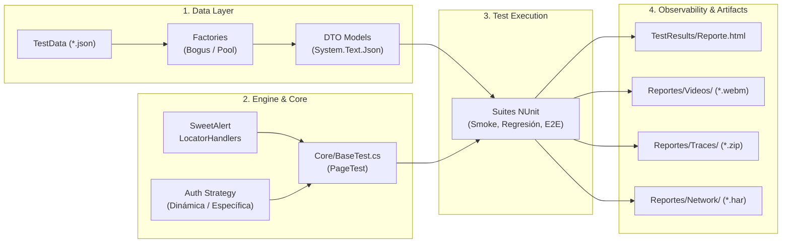

# PinBox E2E Automation Framework
### Testing & Quality Engineering sobre SPA en React | C# · .NET 9 · Playwright · NUnit

[](https://dotnet.microsoft.com/)
[](https://docs.microsoft.com/dotnet/csharp/)
[](https://playwright.dev/)
[](https://nunit.org/)
[](https://react.dev/)
[-orange)](#-arquitectura-de-software-y-patrones)

---

## 📌 Contexto del Proyecto

Framework integral de pruebas **End-to-End (E2E)** desarrollado durante mi servicio social en **Sección Amarilla (Agencia Digital ADN)**.

El objetivo fue diseñar una solución de automatización robusta y desacoplada para validar la plataforma web corporativa **PinBox** (`capacitacionpinbox.seccionamarilla.com`), una Single Page Application (SPA) construida en **React** utilizada por agentes comerciales y coordinadores para cotizaciones de servicios digitales, gestión de clientes y seguimiento de comisiones.

Como **desarrollador Full Stack**, este proyecto combina la comprensión del ciclo de vida del frontend (re-renders de React, eventos sintéticos, estado asíncrono) con la ingeniería de backend (aislamiento de sesiones, monitoreo de llamadas HTTP, desacoplamiento de datos y manejo de errores 500).

---

## 🎯 Retos Técnicos y Decisiones de Ingeniería

| Desafío en la Aplicación (React SPA) | Causa Raíz Identificada | Solución de Ingeniería Implementada |
|---|---|---|
| **Alertas asíncronas intrusivas (SweetAlert2)** | La SPA dispara popups globales por latencia en APIs de terceros que interceptaban clics. | **`LocatorHandlers` resilientes en segundo plano:** `Page.AddLocatorHandlerAsync` neutraliza alertas sin contaminar los tests ni bloquear el hilo. |
| **Pérdida de eventos en formularios React** | `FillAsync` inyecta valores en el DOM sin emitir eventos sintéticos de teclado (`onChange`/`onInput`), impidiendo que el código postal desplegara las colonias. | **Tipeo secuencial simulado:** `PressSequentiallyAsync` garantiza el disparo de los listeners de React y la carga dinámica de datos. |
| **Condiciones de carrera en navegación** | `WaitForLoadState(NetworkIdle)` fallaba por telemetría y llamadas constantes en segundo plano. | **Aserciones deterministas auto-reintentables:** Eliminación de esperas fijas; uso exclusivo de `Expect(locator).ToBeVisibleAsync()`. |
| **Colisiones de datos y validaciones fiscales** | Validaciones de unicidad de RFC/CURP y estados de clientes en base de datos. | **Data-Driven con Bogus y Hash determinista:** Generación de datos sintéticos válidos y pool de clientes con selección determinista por hash de prueba. |
| **Doble autenticación en módulos transaccionales** | Las pruebas de Cotizaciones y Clientes ejecutaban un login innecesario encontrando la sesión ya abierta. | **Estrategia dual de Auth:** `LoginDinamico()` para suites estándar y `LoginEspecifico(user, pass)` controlado para casos atómicos. |

---

## 🏗 Arquitectura de Software y Patrones

El framework está estructurado bajo principios **SOLID** y el patrón **Page Object Model (POM)** con tipado estricto:

```
Playwrigt_Demo/
├── Core/
│   └── BaseTest.cs            # Motor base: ciclo de vida Playwright, Handlers de SweetAlert,
│                              # telemetría (ClickConMonitoreo), auth y recolección de evidencias.
├── Factories/                 # Capa de generación y aprovisionamiento de datos (DDT)
│   ├── ClienteFactory.cs      # Generador con Bogus (personas físicas/morales con RFC/CURP válidos)
│   ├── ClientePoolFactory.cs  # Pool con estrategias: Hash determinista, Round-Robin y Aleatorio
│   └── ProductoFactory.cs     # Catálogo maestro de productos y paquetes comerciales
├── Models/                    # DTOs fuertemente tipados (deserialización System.Text.Json)
│   ├── ClienteModel.cs
│   ├── CotizacionData.cs
│   └── ConfigData.cs
├── TestData/                  # Datasets parametrizados en JSON (Data-Driven Testing)
├── Tests/                     # Suites organizadas por dominio funcional
│   ├── Autenticacion/         # Flujos de Login (QA-LGN)
│   ├── Pagina Principal/       # KPIs, métricas de rendimiento y filtros (QA-PRN)
│   └── Menu Lateral/
│       ├── ML_Gestion/        # Cotizador (69 casos), Clientes Nuevos y 25 pantallas mapeadas
│       ├── ML_Dashboard/      # Comisiones, Tablero y validación de dominios
│       └── ML_Ayuda/          # 11 submódulos de herramientas y soporte
├── Reportes/                  # Artefactos generados (Videos WebM, Traces, HARs y Logs)
└── run-smoke-tests.ps1        # Script de automatización PowerShell para ejecución Headless
```

### Diagrama de Flujo del Framework



---

## 📦 Cobertura Funcional del Negocio

La suite contiene **más de 125 pruebas automatizadas**, cubriendo el flujo operativo completo:

* **Autenticación y Sesiones (`QA-LGN`):** Control del ciclo de vida de tokens, aislamiento entre pruebas (`ClearCookiesAsync`, vaciado de `localStorage`/`sessionStorage`) y validación de roles.
* **Gestión Comercial & Cotizador (`QA-GST`, `QA-CTZ`):** Cobertura exhaustiva de **69 casos Data-Driven** que parametrizan la cotización de productos digitales (ADN Pro, Sitios ADN, Pauta en Redes, SMS masivos, Campañas Carso).
* **Alta de Clientes Nuevos (`QA-CLN`):** Formularios complejos con autocompletado reactivo, validaciones fiscales y carga documental.
* **Disponibilidad de Pantallas Operativas (`QA-VDP` a `QA-HTB`):** Comprobación de disponibilidad sobre 25 pantallas del menú Gestión (Escáner ADN+, Cartera Vencida, Casos, Visor de Plantillas).
* **Métricas y Comisiones (`QA-PRN`, `QA-CMS`, `QA-TBL`):** Validación de integridad en cálculo de comisiones devengadas, descarga de reportes Excel y validación de KPIs comerciales.

---

## 📊 Observabilidad y Reportes Multimedia

Para garantizar reproducibilidad y auditoría técnica de caja negra, cada prueba genera:

1. **Grabación de Video HD (`Reportes/Videos/<Modulo>/<Test>.webm`):** Grabación cuadro por cuadro de la sesión en resolución `1280x720`, organizada por módulo para inspección visual inmediata.
2. **Playwright Tracing (`Reportes/Traces/<Modulo>/<Test>_trace.zip`):** Snapshot completo del DOM, eventos de red, capturas de pantalla intermedias y llamadas de consola. Inspeccionable con:
   ```bash
   pwsh bin/Debug/net9.0/playwright.ps1 show-trace "Reportes/Traces/Smoke/<NombreArchivo>_trace.zip"
   ```
3. **Tráfico de Red HTTP (`Reportes/Network/<Modulo>/<Test>_trafico.har`):** Registro HAR con todas las peticiones y respuestas para diagnosticar caídas o errores `500` en microservicios backend.
4. **Reporte HTML Interactivo (`TestResults/Reporte_*.html`):** Resumen visual de aserciones, tiempos y resultados listo para stakeholders.

---

## 🚀 Puesta en Marcha y Ejecución

### Prerrequisitos
* [.NET SDK 9.0](https://dotnet.microsoft.com/download/dotnet/9.0) instalado.
* PowerShell 5.1 o PowerShell 7 (pwsh).

### 1. Clonar e Instalar Dependencias
```bash
# Restaurar paquetes NuGet y compilar
dotnet restore
dotnet build

# Instalar los navegadores de Playwright (solo la primera vez)
pwsh bin/Debug/net9.0/playwright.ps1 install
```

### 2. Configurar Credenciales Locales
Copia las plantillas `.example.json` en `TestData/` hacia sus versiones activas:
* `TestData/Global_Credentials.example.json` ➔ `TestData/Global_Credentials.json`
* `TestData/ClienteFijo.example.json` ➔ `TestData/ClienteFijo.json`
* `TestData/QA_GST_ClientesAprobados.example.json` ➔ `TestData/QA_GST_ClientesAprobados.json`

---

## ⚡ Comandos de Ejecución

### Script Rápido de Smoke Tests (PowerShell)
Diseñado para la mejor experiencia de desarrollo (*Developer Experience - DX*), corre la suite en **segundo plano (Headless)** y abre automáticamente el reporte al terminar:

```powershell
# Ejecución estándar (Headless + reporte interactivo en navegador)
.\run-smoke-tests.ps1

# Ejecutar combinando suites (Smoke + Sanity)
.\run-smoke-tests.ps1 -Filter "Category=Smoke | Category=Sanity"

# Ejecución desatendida para pipelines de CI/CD
.\run-smoke-tests.ps1 -NoOpenReport
```

### Ejecución con `dotnet test` (CLI)

```bash
# Suite de Smoke con reporte HTML
dotnet test --filter "Category=Smoke" --logger "html;LogFileName=Reporte_Smoke.html"

# Suite completa
dotnet test --logger "html;LogFileName=Reporte_Suite_Completa.html"

# Filtrar por módulo específico
dotnet test --filter "Name~QA_LGN"   # Autenticación
dotnet test --filter "Name~QA_GST"   # Cotizaciones y Gestión
dotnet test --filter "Name~QA_CMS"   # Comisiones

# Modo interactivo con navegador visible (Headed + SlowMo para demostraciones)
$env:HEADED="1"; $env:PLAYWRIGHT_SLOWMO="500"; dotnet test --filter "Category=Smoke"
```

### Ejecución en JetBrains Rider o Visual Studio
* Abre `Playwrigt_Demo.sln`.
* Explora y ejecuta tests visualmente desde la ventana **Unit Tests** (`Alt + 8` en Rider).
* Soporta depuración paso a paso (*breakpoints*) pausando el navegador y permitiendo inspeccionar variables y el DOM en tiempo real.

---

## 💡 Habilidades y Buenas Prácticas Demostradas

* **Frontend Savvy:** Comprensión de SPA en React, manejo de asincronía, manipulación de listeners y solución a race conditions.
* **Backend & Network Awareness:** Diagnóstico de APIs mediante archivos HAR, análisis de respuestas HTTP y manejo de errores de backend sin código fuente accesible.
* **Diseño Orientado a Objetos y Limpieza:** Patrón POM estricto, desacoplamiento con DTOs fuertemente tipados y eliminación de dependencias circulares.
* **Automatización & DX:** Creación de scripts PowerShell para integración rápida y telemetría de tiempos de respuesta en UI.

---

> **Desarrollado por:** Axel  
> **Rol:** Full Stack Developer (Testing & Software Quality)  
> **Organización:** Sección Amarilla / Agencia Digital ADN (Servicio Social)  
> **Licencia:** Proyecto de portafolio técnico con autorización empresarial.
